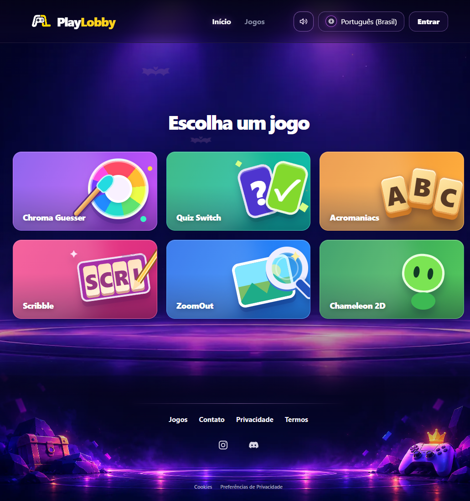
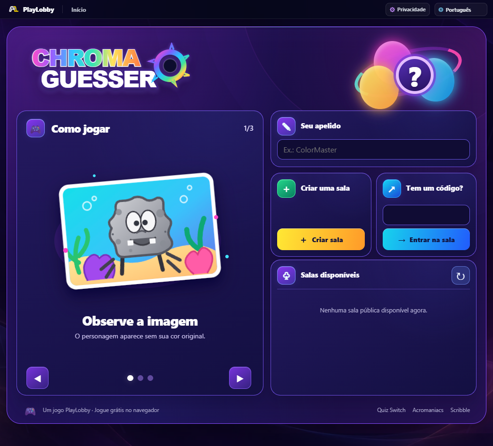
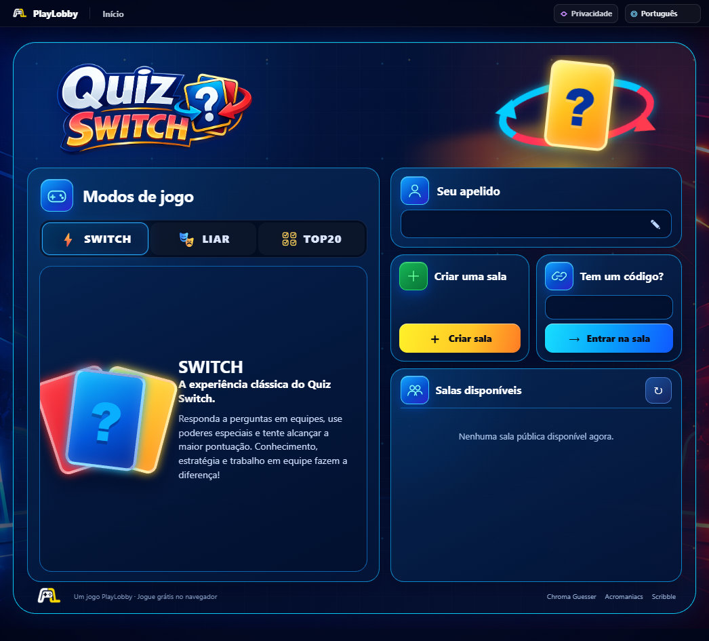
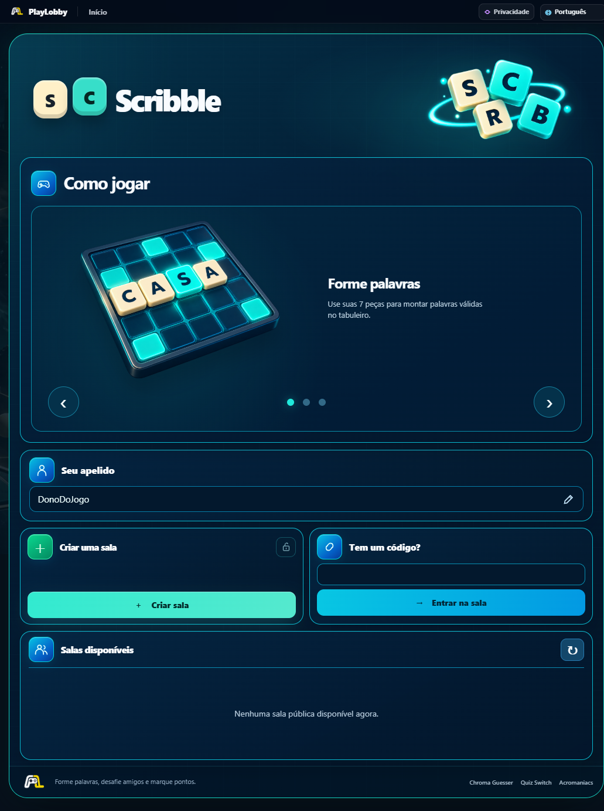
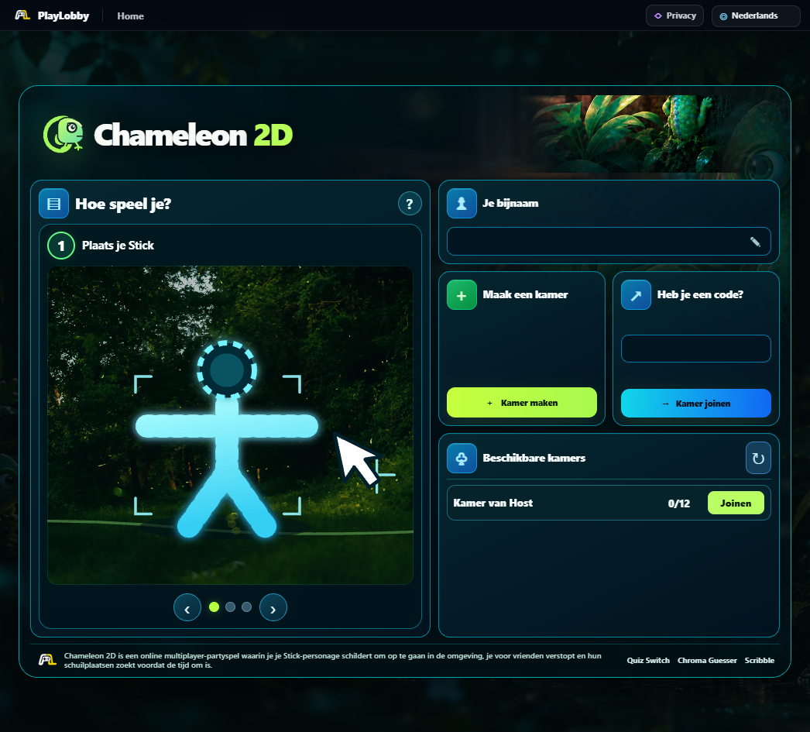
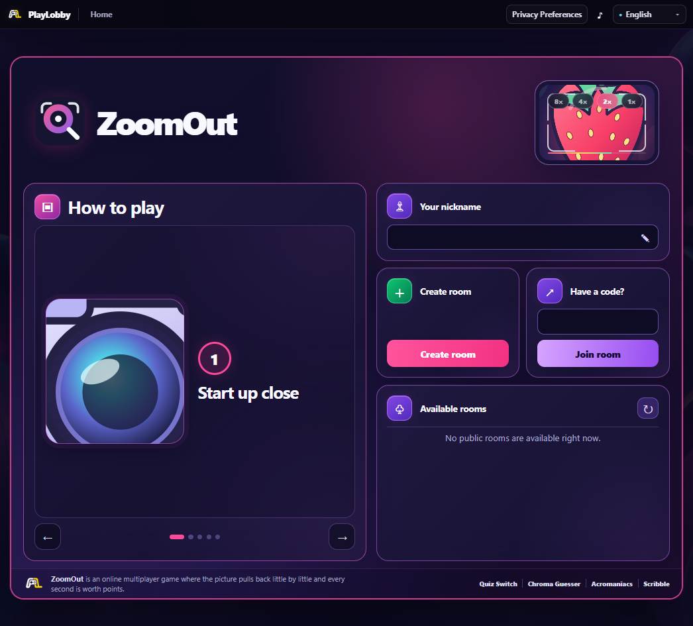
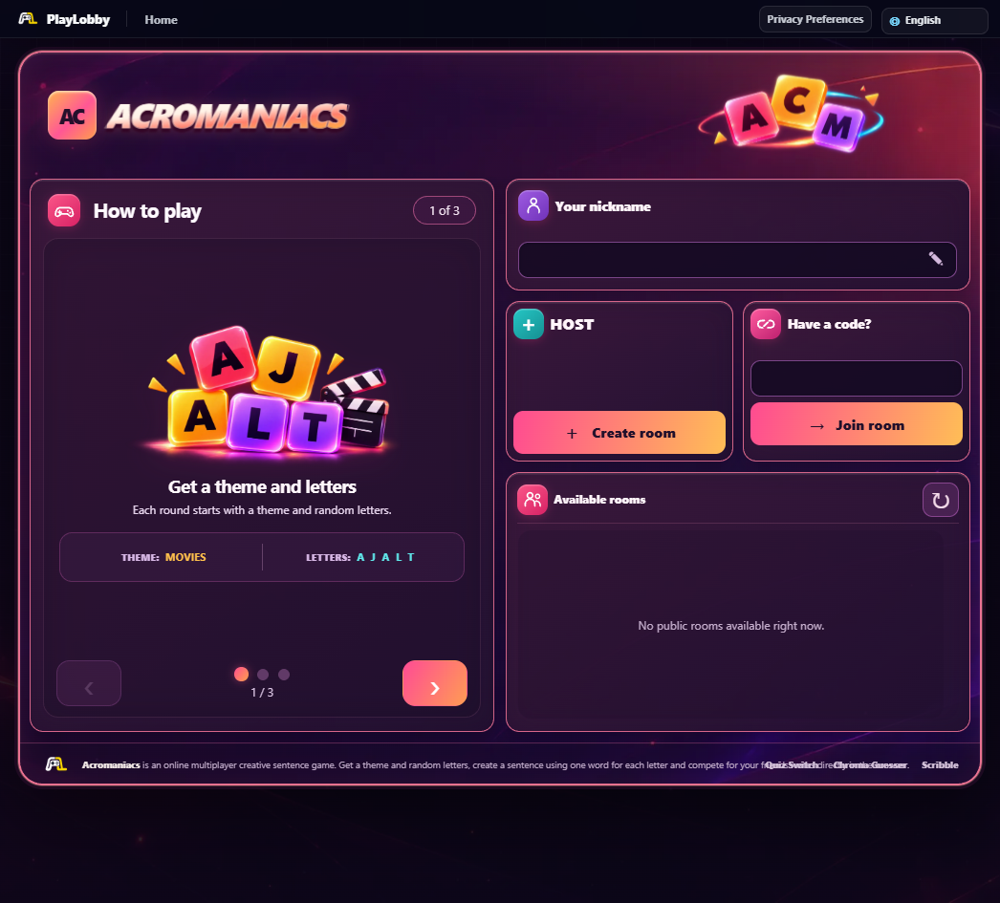

# PlayLobby — Multiplayer Party Games

**A browser-based collection of social games built around playing together, in real time.**

[**Visit PlayLobby**](https://playlobby.online) · [**Explore the games**](https://playlobby.online/games)

> **Public project showcase.** This repository is intended to document the product, its design decisions, and my experience building and testing it through an AI-assisted workflow. It does **not** contain the private application source code, production infrastructure, user data, or credentials.

## A look at the platform

  

*Real screenshot of the PlayLobby home page in Brazilian Portuguese. Click the image to visit the platform.*

## Overview

PlayLobby brings different multiplayer party games into one web platform. The guiding design principle is simple: **people should be interacting in the same shared session**, rather than playing isolated games and comparing scores afterward.

The project involves more than individual games. It also explores the surrounding product experience: discovering games, entering rooms, inviting friends, understanding rules, supporting multiple languages, and making multiplayer sessions easier to use on desktop and mobile devices.

## Playable games

| Game | Experience | Play |
| --- | --- | --- |
| **Chroma Guesser** | Re-create missing colors and compare your choices against the original image and other players. | [Open game](https://chromaguesser.playlobby.online/) |
| **Quiz Switch** | A social quiz and bluffing experience for groups. | [Open game](https://quizswitch.playlobby.online/) |
| **Acromaniacs** | Create imaginative sentences from random initials, then vote on the best results. | [Open game](https://acromaniacs.playlobby.online/) |
| **Scribble** | A multiplayer word-building game with letter tiles and shared rounds. | [Open game](https://scribble.playlobby.online/) |
| **ZoomOut** | A visual guessing game built around recognizing images from limited visual information. | [Open game](https://zoomout.playlobby.online/) |
| **Chameleon 2D** | Camouflage characters in a shared environment, then try to find the other players. | [Open game](https://chameleon2d.playlobby.online/) |

The links above point to the public PlayLobby website. Features and availability may evolve as the product is updated.

## Product and UX challenges

Building a shared multiplayer experience requires careful attention to the **complete player journey**, not just game mechanics.

- **Multiplayer synchronization:** Keeping players in the same room and round, with consistent progression and shared results.
- **Room experience:** Making it understandable to create or join a session, invite friends, and recover from interruptions.
- **Usability:** Improving navigation, responsive layouts, onboarding, buttons, and visual feedback.
- **Game variety:** Designing different interaction patterns while maintaining a recognizable platform identity.
- **International experience:** Working with multilingual interfaces and understandable instructions.
- **Reliability:** Investigating regressions, checking edge cases, and validating changes before release.

## My role and working process

I use **AI-assisted development tools** to turn product ideas into testable software, then take an active role in specifying behavior, testing results, reporting problems, and iterating toward better experiences.

My practical contributions and areas of focus include:

1. **Product requirements:** Defining gameplay behavior, user flows, rules, and acceptance criteria.
2. **Interface iteration:** Reviewing visual consistency, usability, responsive behavior, and player feedback.
3. **Manual QA:** Reproducing bugs across game states and browsers, validating fixes, and running regression checks.
4. **Troubleshooting:** Working through issues involving multiplayer state, application behavior, and deployment workflows.
5. **Release preparation:** Organizing changes, reviewing test results, and considering deployment and rollback risks.
6. **Documentation:** Converting technical findings into clear steps and structured project notes.

**Transparency:** My workflow relies on AI coding assistance. This showcase does not imply that I independently authored every implementation detail or that I am an expert in every technology used by the platform.

## Technologies encountered

**Web:** JavaScript, TypeScript, React / Next.js, HTML, CSS, Node.js  
**Real-time and data:** Multiplayer session management, WebSocket and event-driven communication patterns, SQL-backed application components  
**Delivery:** Git / GitHub, Docker, Linux hosting workflows, reverse-proxy configuration  
**Quality:** Manual testing, regression verification, browser checks, debugging, and issue documentation

These technologies reflect work across the project and its components, not a claim of expert-level independent proficiency in each one.

## Selected lessons

- A multiplayer game needs to be tested as a **shared group experience**, not only in one browser window.
- Small interface bugs can affect confidence just as much as backend failures.
- Clear reproducible steps make AI-assisted debugging and human verification more reliable.
- Releasing safely involves more than a passing build: it also requires checking the real experience and understanding operational risks.

## Screenshots and demos

**Seven original product screenshots**, provided from the live interfaces, show the portal and all six listed games. The images intentionally retain their original interface languages to demonstrate localization in practice.

| Chroma Guesser — Portuguese (Brazil) | Quiz Switch — Portuguese (Brazil) |
|:---:|:---:|
|  |  |
| **Scribble — Portuguese (Brazil)** | **Chameleon 2D — Dutch (Nederlands)** |
|  |  |
| **ZoomOut — English** | **Acromaniacs — English** |
|  |  |

*Click any screenshot to open that game's website. These are real interface captures, not AI-generated mockups. They show lobby/onboarding screens rather than full in-progress multiplayer matches.*

### Multilingual experience

Language support is part of the product experience, not just a planned feature. These screenshots deliberately show different locales:

- **Português (Brasil):** platform home, Chroma Guesser, Quiz Switch, and Scribble.
- **Nederlands:** Chameleon 2D.
- **English:** ZoomOut and Acromaniacs.

The portal also includes localized routes for **English, Portuguese, Spanish, French, German, and Dutch**. Language availability varies by game, so the screenshots illustrate real examples rather than claiming that every game supports every language.

**Explore the live platform:** [playlobby.online](https://playlobby.online).

## Opportunities and collaboration

I am interested in remote roles where my product experience, practical troubleshooting, and user-centered testing can be useful, including:

**Technical Support · Product Support · Customer Support · Manual QA · AI-Assisted Product Operations**

[**View my GitHub profile**](https://github.com/caiovitor2006-gif)

---

### Repository scope

**Documentation and product presentation only.** The underlying PlayLobby source code and infrastructure configuration remain private. This repository is not an open-source release and does not grant redistribution rights to the games, assets, or branding.
